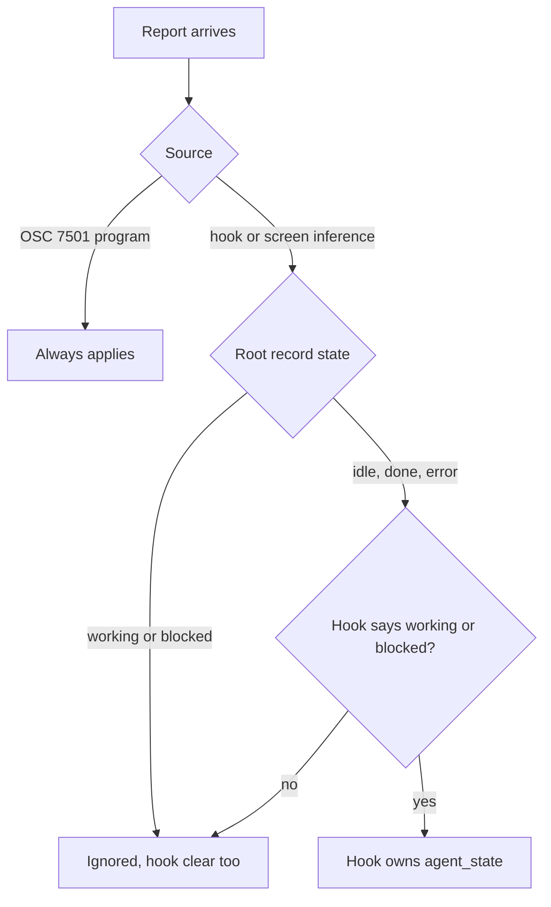

# Program status (OSC 7501)

A program running in a Programa terminal can report what it is doing with the Program Status
Protocol, an OSC 7501 escape sequence. Programa shows the result in the sidebar, posts
notifications, and exposes it on the socket.

```sh
printf '\e]7501;state=working:progress=40:app=cargo\e\\'
printf '\e]7501;state=done:msg=%s\e\\' "$(printf 'Build finished' | base64)"
printf '\e]7501;state=clear\e\\'
```

## Keys

Pairs are separated by `:` and split on the first `=`. Unknown keys are ignored. If a key
repeats, the last value wins.

| Key | Meaning |
|---|---|
| `state` | Required. `idle`, `working`, `done`, `blocked`, `error`, or `clear`. |
| `id` | The record this report is about. Without it the report is about the program itself (the root record). A `/` makes a child: `deploy/us-east` is a child of `deploy`. Up to 8 segments of 1-32 characters from `A-Za-z0-9_.+-`, 128 bytes in total. |
| `kind` | Only read when `state=blocked`: `permission`, `question`, or `auth`. |
| `progress` | Only read when `state` is `working` or `blocked`: an integer from 0 to 100. |
| `app` | A stable name for the program, 1-32 characters from `A-Za-z0-9_.+-`. A child without `app` uses its nearest ancestor's. |
| `title`, `msg` | Standard base64 text, padding optional. At most 192 and 2048 decoded bytes, valid UTF-8, no control characters. |

A report replaces its record completely. A report with an invalid id, invalid text or an unknown
state is discarded whole. `state=clear` removes the record named by `id` and every descendant
(`a` removes `a/b`, not `ab`); without `id` it removes all records. Each terminal holds at most
256 records: a report that would create the 257th is discarded, and updates to existing ids
still apply. Records are not saved with the session.

## Lifetimes

- A shell prompt (shell integration) removes `working` and `blocked` records at every depth.
  `done`, `error` and `idle` survive prompts.
- A full terminal reset (`printf '\ec'`) removes all records.
- Closing the surface removes its records. A program that exits without a shell prompt being
  printed keeps its record until the next report, a clear, or a reset.

## What Programa shows

The root record drives the terminal's own status. Child records show up as helpers.

- Helpers: every child record appears in the workspace's
  [helpers popover](workspace-interface.md#helpers-popover) (the "N helpers running" line on
  the sidebar row), with its `title` as the name, `app` under it, a progress bar
  when `progress` is set, and `msg` as the report preview. `done` and `error` children fold under
  Finished; Clear removes them from the list and from the terminal's records. Child records never
  reach the socket: `agent.task.list` and `workspace.list` count only helpers reported there.
- A child whose last id segment is a helper's id from `agent.task.start` (as 32 hex digits, since
  a segment holds at most 32 characters) updates that helper's state and progress instead of
  adding a row. Only `working` and `blocked` apply; the socket report finishes the helper.
- When a child record enters `blocked` on a surface you are not looking at, Programa posts one
  notification naming the program's `app` ("A deployer task needs your input"), at most one per
  10 seconds per surface. Its `title` and `msg` stay out of it, for the same reason as below.

- Sidebar: `working` and `blocked` show as before; `done` and `error` show a check and a stop
  icon. A blocked or working surface in the same workspace outranks them.
- Notifications: when the root record enters `blocked`, `done` or `error` on a surface you are
  not looking at, Programa posts one notification, at most one per 10 seconds per surface. The
  notification title is the Programa tab title and the body names the state. The program's
  `title` and `msg` stay out of it, because `notification.list` returns notification text over
  the socket and the spec forbids revealing record contents back to programs. Workspaces with a hook-managed agent are skipped, since the hooks notify.
  There is no setting for this.
- Socket: `surface.list` and `system.tree` return `program_status`, and `surface.wait` accepts
  `program_state`. Record text and child ids are never returned. See `docs/socket-api.md`.
- `agent_state` projects the root record: `working` and `blocked` map to themselves, and `idle`,
  `done` and `error` map to `idle`. The surface's `agent_state_source` reads `"program"`.

## Authority

OSC 7501 outranks hooks, and hooks outrank screen inference.

1. A program report always applies.
2. While the root record is `working` or `blocked`, hook and inferred reports are ignored.
3. While the root record is `idle`, `done` or `error`, a hook report is accepted only if it says
   `working` or `blocked`. Then the hook owns the surface's `agent_state`, and the record stays
   visible in `program_status`.
4. Screen inference does not run on a surface that a program or a hook owns.
5. While the program owns the surface, a hook or inferred clear is ignored in every state.

`surface.report_agent_state` rejects `source: "program"`.

The diagram shows a report for a surface whose `agent_state` the program owns:



## Hooks emit it too

The Claude Code, Codex and OpenCode hooks write OSC 7501 to the terminal as well as reporting to
the socket, so the report also reaches a terminal where the socket is out of reach, such as an SSH
session. The Claude Code hooks also report each subagent as the child record
`agents/<helper id>`: `working` from SubagentStart and each of its tool calls, `blocked` when it
asks for permission or input, and `done` with the first line of its report. Its `title` is the task
description Claude gave it, or its agent type. They emit only when `PROGRAMA_SURFACE_ID` is set, and they skip emission inside tmux
(`TMUX` is set), where the sequence would need passthrough and can reach the wrong pane.

## Not covered

OSC 9;4 progress is a separate feature and is not mapped to program status.
