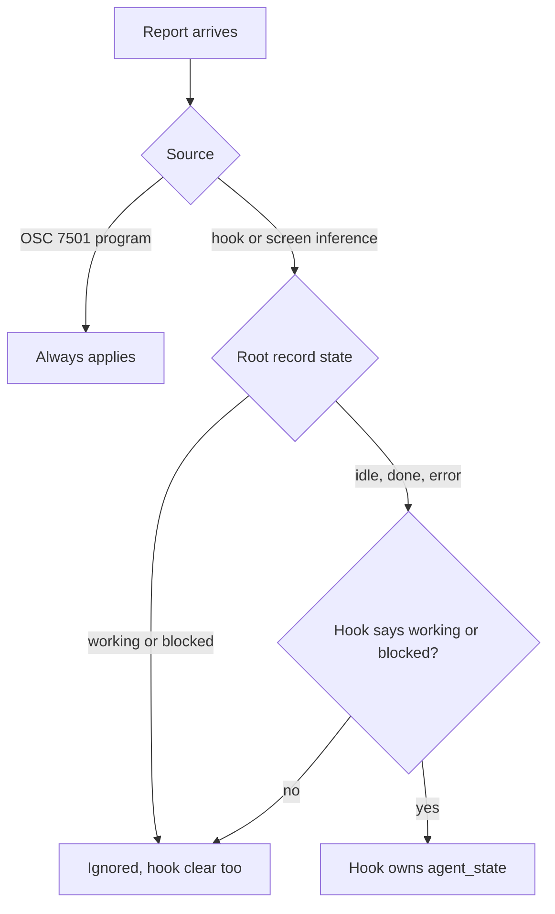

# Program status (OSC 7501)

A program running in a Programa terminal can report what it is doing with the Program Status
Protocol, an OSC 7501 escape sequence. Programa shows the result in the sidebar, posts
notifications, and exposes it on the socket.

```sh
printf '\e]7501;state=working:progress=40:app=cargo\e\\'
printf '\e]7501;state=done:msg=%s\e\\' "$(printf 'Build finished' | base64)"
printf '\e]7501;state=clear\e\\'
```

## Keys

Pairs are separated by `:` and split on the first `=`. Unknown keys are ignored. If a key
repeats, the last value wins.

| Key | Meaning |
|---|---|
| `state` | Required. `idle`, `working`, `done`, `blocked`, `error`, or `clear`. |
| `id` | The record this report is about. Without it the report is about the program itself (the root record). A `/` makes a child: `deploy/us-east` is a child of `deploy`. Up to 8 segments of 1-32 characters from `A-Za-z0-9_.+-`, 128 bytes in total. |
| `kind` | Only read when `state=blocked`: `permission`, `question`, or `auth`. |
| `progress` | Only read when `state` is `working` or `blocked`: an integer from 0 to 100. |
| `app` | A stable name for the program, 1-32 characters from `A-Za-z0-9_.+-`. A child without `app` uses its nearest ancestor's. |
| `title`, `msg` | Standard base64 text, padding optional. At most 192 and 2048 decoded bytes, valid UTF-8, no control characters. |
| `programa_token` | Programa's own extension: the terminal's `PROGRAMA_STATUS_TOKEN`, which marks the report as coming from Programa's agent hooks. See [Signed reports](#signed-reports). |

A report replaces its record completely. A report with an invalid id, invalid text or an unknown
state is discarded whole. `state=clear` removes the record named by `id` and every descendant
(`a` removes `a/b`, not `ab`); without `id` it removes all records. Each terminal holds at most
256 records: a report that would create the 257th is discarded, and updates to existing ids
still apply. Records are not saved with the session.

## Lifetimes

- A shell prompt (shell integration) removes `working` and `blocked` records at every depth.
  `done`, `error` and `idle` survive prompts.
- A full terminal reset (`printf '\ec'`) removes all records.
- Closing the surface removes its records. A program that exits without a shell prompt being
  printed keeps its record until the next report, a clear, or a reset.

## What Programa shows

The root record drives the terminal's own status. Child records show up as helpers.

- Helpers: every child record appears in the workspace's
  [helpers popover](workspace-interface.md#helpers-popover) (the "N helpers running" line on
  the sidebar row), with its `title` as the name, `app` under it, a progress bar
  when `progress` is set, and `msg` as the report preview. `done` and `error` children fold under
  Finished; Clear removes them from the list and from the terminal's records. Child records never
  reach the socket: `agent.task.list` and `workspace.list` count only helpers reported there.
- A child whose last id segment is a helper's id from `agent.task.start` (as 32 hex digits, since
  a segment holds at most 32 characters) updates that helper's state and progress instead of
  adding a row. Only `working` and `blocked` apply; the socket report finishes the helper.
- When a child record enters `blocked` on a surface you are not looking at, Programa posts one
  notification naming the program's `app` ("A deployer task needs your input"), at most one per
  10 seconds per surface. Its `title` and `msg` stay out of it, for the same reason as below.

- Sidebar: `working` and `blocked` show as before; `done` and `error` show a check and a stop
  icon. A blocked or working surface in the same workspace outranks them.
- Notifications: when the root record enters `blocked`, `done` or `error` on a surface you are
  not looking at, Programa posts one notification, at most one per 10 seconds per surface. The
  notification title is the Programa tab title and the body names the state. The program's
  `title` and `msg` stay out of it, because `notification.list` returns notification text over
  the socket and the spec forbids revealing record contents back to programs. Workspaces with a hook-managed agent are skipped, since the hooks notify.
  There is no setting for this.
- Socket: `surface.list` and `system.tree` return `program_status`, and `surface.wait` accepts
  `program_state`. Record text and child ids are never returned. See `docs/socket-api.md`.
- `agent_state` projects the root record: `working` and `blocked` map to themselves, and `idle`,
  `done` and `error` map to `idle`. The surface's `agent_state_source` reads `"program"`.

## Signed reports

Anything that reaches the terminal can print an OSC 7501 report, including untrusted text an agent
shows, such as a file preview with raw escape bytes in a permission dialog. So Programa only takes
a report as the agent's own when it is signed:

- Each shell Programa spawns gets a random 128-bit `PROGRAMA_STATUS_TOKEN` (32 hex digits) in its
  environment, next to `PROGRAMA_SURFACE_ID`. Programa's Claude Code, Codex and OpenCode hooks add
  it to every report as `programa_token=<token>`.
- A report whose token matches the terminal's is signed. A report with another token is
  discarded whole. A report without one is unsigned: it still updates the records, the sidebar
  and `agent_state` exactly as a program report always has, but it never counts as the agent for
  [event routes](plans/event-routes.md) (see [Authority](#authority)): an unsigned
  working-then-idle pair cannot release a route's `send` or `prompt` text.
- An unsigned report can start an [approval-prompt refusal](socket-api.md#approval-prompts-agent_awaiting_approval)
  but never lifts one. An unsigned `working`, `idle` or `clear`, a shell prompt and a reset still
  change the badge and the records, but socket writes stay refused until the person answers the
  prompt or another event listed there lifts it, such as a signed `state=clear`.
- The app keeps only the token's SHA-256 digest and compares digests in constant time, and never
  logs the token. The token still sits in the shell's environment, and signed reports are terminal
  output, so the session's scrollback log on disk holds them as written. The session snapshot keeps
  the digest, so a shell revived after a relaunch keeps signing. A shell recovered without its
  snapshot entry, or spawned before this release, sends reports Programa cannot check, and they
  count as unsigned.
- Programa never forwards the token over SSH, and the hooks leave it out of a report inside an
  SSH session, so a remote report is unsigned.
- Claude Code 2.1.295 and later report their own status without the token. Those reports are
  unsigned: they drive the badge, and the hooks' socket reports are what routes see.

## Authority

Programa keeps two views of a surface's agent. `agent_state` and the sidebar badge show what the
agent is doing. Event routes read a second view that only trusted reporters move: hooks over the
socket, and signed program reports.

For `agent_state` and the badge, OSC 7501 (signed or not) outranks hooks, and hooks outrank
screen inference.

1. A program report always applies.
2. While the root record is `working` or `blocked`, hook and inferred reports are ignored.
3. While the root record is `idle`, `done` or `error`, a hook report is accepted only if it says
   `working` or `blocked`. Then the hook owns the surface's `agent_state`, and the record stays
   visible in `program_status`.
4. Screen inference does not run on a surface that a program or a hook owns.
5. While the program owns the surface, a hook or inferred clear is ignored in every state.

For event routes, the same rules apply between signed program reports and hooks, and unsigned
program reports and screen inference never move the view. Only that view names a writer
(`program` for signed reports, the hook session for hooks) and only its `working` to `idle`
releases held `send` or `prompt` text. Everything else a text route decides also reads that view
once it exists: whether the agent is busy (`whenBusy: queue`), whether a `prompt` may press
Return, and which surfaces count as blocked when routes install. A signed root report reaches the
view as Programa reads it, even when an unsigned report later in the same burst ends up on the
badge. So on a Claude Code terminal:

- Claude's own unsigned status drives the badge, and its hooks drive routes.
- While Claude reports its own status, its PostToolUse hook moves only the routes' view to
  `working` (`surface.report_agent_state` with `route_only` and `resumed`), so routes see the agent
  resume after a permission prompt while the badge stays Claude's. PostToolUse runs only after the
  tool did, so the prompt was answered, and it is a synchronous hook, so its report lands before the
  next tool's prompt can. The async PreToolUse hook could land after that prompt, so it reports
  nothing here.
- Only a report that proves the prompt was answered ends a stop for input in the routes' view: a
  hooks report, a signed program report, or a route-only report marked `resumed`. A route-only
  report without it never moves a blocked view.
- After Esc, Claude reports idle itself and fires no Stop hook: the badge leaves Working, but held
  route text waits for the next turn's Stop hook, or expires.
- A hook clear (SessionEnd) ends the routes' view even while the badge stays with the program.
- A signed clear, or a shell prompt the shell integration also reported over the socket, removes
  the badge and ends the routes' view, so a held delivery ends instead of waiting on an agent that
  is gone. An unsigned clear, a prompt the shell did not report, and a reset can be printed, so
  they remove the program's record but keep the routes' view, and the badge falls back to it.
  Screen detection losing its match does the same with its own badge. The
  hooks, the pid check or `surface.clear_agent_state` end a fallback to the hooks' view; the
  agent's next signed report, its signed clear or the shell reporting its prompt over the socket
  ends a fallback to a signed one.

A surface no trusted reporter has spoken for, such as one where only a program prints its own
status or only screen detection sees an agent, hands routes its `agent_state` changes without a
writer and marked as untrusted. `notify` routes fire on them. `run` and `review` routes count the
match but do not fire, keep their throttle window, and set their last error to a line starting
with `refused:`. Text routes never deliver on them. The same holds for a clear printed bytes can
cause (an unsigned clear, a prompt the shell did not report, a reset) and for screen detection's
clear, and for any clear of an agent that only those untrusted reporters reported, such as a
printed `working` that the shell's own prompt then clears. A signed clear, a hooks clear, a shell
prompt the shell reported over the socket and a closed surface are trusted when the agent they end
came from a trusted reporter, so a hooked agent's session end still fires `run` and `review`
routes on `agent/+/state/none`. A program that wants `run` and
`review` routes to fire on its status signs its reports with `programa_token`.

`surface.report_agent_state` rejects `source: "program"`.

The diagram shows a report for a surface whose `agent_state` the program owns:



## Hooks emit it too

The Claude Code, Codex and OpenCode hooks write signed OSC 7501 to the terminal as well as reporting to
the socket, so the report also reaches a terminal where the socket is out of reach, such as an SSH
session. The Claude Code hooks also report each subagent as the child record
`agents/<helper id>`: `working` from SubagentStart and each of its tool calls, `blocked` when it
asks for permission or input, and `done` with the first line of its report. Its `title` is the task
description Claude gave it, or its agent type. They emit only when `PROGRAMA_SURFACE_ID` is set, and they skip emission inside tmux
(`TMUX` is set), where the sequence would need passthrough and can reach the wrong pane.

## Not covered

OSC 9;4 progress is a separate feature and is not mapped to program status.
